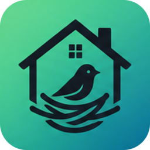

<p align="center">
  
</p>

<h1 align="center">furnest</h1>

<p align="center">self-hosted furnished-rental monitor</p>

A self-hosted monitor for furnished rental listings. furnest watches several listing sources, filters and scores what it finds against your criteria, posts matches to Discord with action buttons, drafts inquiry emails, and tracks every property through a review pipeline in a small web dashboard.

## Features

- Watches several furnished-rental sources on a schedule through per-source adapters ([docs/adapters.md](docs/adapters.md)).
- Filters and scores listings against your criteria, and groups duplicates of the same property across sources.
- Posts matches to Discord with approve/deny/snooze buttons ([docs/discord-setup.md](docs/discord-setup.md)).
- Drafts or sends inquiry emails and reads replies by IMAP.
- Tracks every property through a review pipeline in a small web dashboard (list, board or map), with a JSON API.
- Self-hosted: one Docker image, SQLite, no external services required ([docs/deployment.md](docs/deployment.md)).

<!-- Screenshots: add images of the dashboard, a property page and a Discord post under docs/screenshots/ and link them here. -->
*Screenshots coming soon.*

## Quickstart

```sh
cp .env.example .env     # set AUTH_TOKEN and AUTH_SESSION_SECRET (random, 16+ characters)
docker compose up -d --build
```

Open <http://127.0.0.1:8000> and sign in with `AUTH_TOKEN`. Then set your search criteria (add an area by typing a city and state, such as "Springfield, IL", and furnest fills in its centre and a 50-mile radius from a bundled, offline US places dataset) and, on the Sources page, switch on the sources you want, give each its search locations, and paste the Apify token for the sources that need one. See [docs/deployment.md](docs/deployment.md) for Portainer and Caddy.

## Scraping and terms of service

furnest fetches pages and APIs on your behalf, for your own personal search. Many listing sites forbid automated access in their terms of service, and some actively block it. You are responsible for checking and following the terms, robots.txt and laws that apply to each source you enable. furnest keeps request rates low by default and honours robots.txt (`SOURCES_RESPECT_ROBOTS`), and sources that need a data provider or API key are off until you configure them. Don't use it to resell, republish or bulk-collect listings or personal data. The software is provided as is, with no warranty (see [LICENSE](LICENSE)), and the authors are not affiliated with any listing site.

## Development

Requires [uv](https://docs.astral.sh/uv/). uv installs Python 3.12 itself if you don't have it.

```sh
uv sync                       # create .venv and install dependencies
uv run furnest --help         # web | worker | migrate | healthcheck
uv run pytest                 # tests + coverage
uv run ruff check . && uv run ruff format --check . && uv run mypy
uv run pre-commit install     # optional: run the same checks on every commit
```

[CONTRIBUTING.md](CONTRIBUTING.md) covers the workflow and how to refresh adapter fixtures from a live page (`scripts/capture_fixture.py`). [docs/BRAND.md](docs/BRAND.md) has the logo, palette and asset files.

Schema changes ship as Alembic migrations in `src/furnest/db/migrations/versions/`:

```sh
export DB_URL=sqlite:///./dev.db
uv run furnest migrate                                    # upgrade to head
uv run alembic revision --autogenerate -m "add listings"  # then review the generated file
uv run alembic check                                      # models and migrations agree
```

## Configuration

furnest is configured through environment variables, or a `.env` file in the working directory. [`.env.example`](.env.example) documents every setting. Copy it to `.env` and fill in what you use. Optional integrations (Sentry, LLM, geocoding, reverse image search, IMAP) stay off until configured.

Every setting, with its type and default (the table is generated from the code and checked in CI; refresh it with `uv run python scripts/gen_config_docs.py`):

<!-- config-table:begin -->

| Variable | Type | Default |
| --- | --- | --- |
| `ENVIRONMENT` | development \| production \| test | `production` |
| `BASE_URL` | httpurl | `http://localhost:8000/` |
| `DATA_DIR` | path | `/data` |
| `INQUIRY_MODE` | auto \| review | `review` |
| `TIMEZONE` | string | `UTC` |
| `DB_URL` | string | unset |
| `DB_BUSY_TIMEOUT_MS` | integer | `5000` |
| `DB_AUTO_MIGRATE` | boolean | `false` |
| `WEB_HOST` | string | `127.0.0.1` |
| `WEB_PORT` | integer | `8000` |
| `WEB_TRUSTED_PROXIES` | list | unset |
| `WORKER_HEARTBEAT_MAX_AGE_SECONDS` | integer | `120` |
| `WORKER_HEARTBEAT_INTERVAL_SECONDS` | integer | `30` |
| `WORKER_POLL_INTERVAL_SECONDS` | number | `2.0` |
| `WORKER_CONCURRENCY` | integer | `2` |
| `WORKER_JOB_TIMEOUT_SECONDS` | integer | `300` |
| `WORKER_RETRY_BASE_SECONDS` | integer | `30` |
| `WORKER_RETRY_MAX_SECONDS` | integer | `3600` |
| `WORKER_SHUTDOWN_TIMEOUT_SECONDS` | integer | `25` |
| `AUTH_TOKEN` | secret | unset |
| `AUTH_SESSION_SECRET` | secret | unset |
| `AUTH_COOKIE_SECURE` | boolean | `true` |
| `AUTH_SESSION_MAX_AGE_SECONDS` | integer | `604800` |
| `AUTH_SESSION_IDLE_TIMEOUT_SECONDS` | integer | `0` |
| `AUTH_LOGIN_MAX_ATTEMPTS` | integer | `5` |
| `AUTH_LOGIN_WINDOW_SECONDS` | integer | `300` |
| `SENTRY_DSN` | secret | unset |
| `SENTRY_ENVIRONMENT` | string | unset |
| `SENTRY_TRACES_SAMPLE_RATE` | number | `0.0` |
| `METRICS_ENABLED` | boolean | `false` |
| `LOG_LEVEL` | DEBUG \| INFO \| WARNING \| ERROR \| CRITICAL | `INFO` |
| `LOG_FORMAT` | json \| console | `json` |
| `DISCORD_APPLICATION_ID` | string | unset |
| `DISCORD_PUBLIC_KEY` | string | unset |
| `DISCORD_BOT_TOKEN` | secret | unset |
| `DISCORD_CHANNEL_ID` | string | unset |
| `DISCORD_ALLOWED_USER_IDS` | list | unset |
| `DISCORD_REQUEST_TIMEOUT_SECONDS` | number | `10.0` |
| `DISCORD_MAX_RETRIES` | integer | `3` |
| `DISCORD_INTERACTION_MAX_AGE_SECONDS` | integer | `300` |
| `DISCORD_DIGEST_TIME` | time | unset |
| `DISCORD_DIGEST_TOP` | integer | `5` |
| `DISCORD_ALERT_AFTER_FAILURES` | integer | `3` |
| `SMTP_HOST` | string | unset |
| `SMTP_PORT` | integer | `587` |
| `SMTP_USERNAME` | string | unset |
| `SMTP_PASSWORD` | secret | unset |
| `SMTP_SECURITY` | starttls \| ssl \| none | `starttls` |
| `SMTP_FROM_ADDRESS` | emailstr | unset |
| `SMTP_FROM_NAME` | string | unset |
| `SMTP_TIMEOUT_SECONDS` | number | `30.0` |
| `IMAP_ENABLED` | boolean | `false` |
| `IMAP_HOST` | string | unset |
| `IMAP_PORT` | integer | `993` |
| `IMAP_USERNAME` | string | unset |
| `IMAP_PASSWORD` | secret | unset |
| `IMAP_SECURITY` | starttls \| ssl \| none | `ssl` |
| `IMAP_FOLDER` | string | `INBOX` |
| `IMAP_POLL_INTERVAL_SECONDS` | integer | `300` |
| `IMAP_TIMEOUT_SECONDS` | number | `30.0` |
| `IMAP_LOOKBACK_DAYS` | integer | `14` |
| `LLM_PROVIDER` | none \| anthropic \| openai_compatible | `none` |
| `LLM_API_KEY` | secret | unset |
| `LLM_MODEL` | string | unset |
| `LLM_BASE_URL` | httpurl | unset |
| `LLM_TIMEOUT_SECONDS` | number | `30.0` |
| `GEOCODING_PROVIDER` | none \| nominatim | `none` |
| `GEOCODING_BASE_URL` | httpurl | unset |
| `GEOCODING_API_KEY` | secret | unset |
| `GEOCODING_USER_AGENT` | string | unset |
| `GEOCODING_REQUESTS_PER_MINUTE` | number | `60.0` |
| `GEOCODING_TIMEOUT_SECONDS` | number | `10.0` |
| `GEOCODING_MISS_TTL_DAYS` | integer | `30` |
| `REVERSE_IMAGE_PROVIDER` | none \| serpapi \| tineye \| bing | `none` |
| `REVERSE_IMAGE_API_KEY` | secret | unset |
| `REVERSE_IMAGE_TIMEOUT_SECONDS` | number | `30.0` |
| `REVERSE_IMAGE_MAX_RESULTS` | integer | `10` |
| `REVERSE_IMAGE_MAX_PHOTOS` | integer | `3` |
| `IMAGES_ENABLED` | boolean | `true` |
| `IMAGES_INTERVAL_MINUTES` | integer | `10` |
| `IMAGES_BATCH_SIZE` | integer | `50` |
| `IMAGES_PER_LISTING` | integer | `10` |
| `IMAGES_MAX_BYTES` | integer | `10000000` |
| `IMAGES_MAX_PIXELS` | integer | `40000000` |
| `IMAGES_TIMEOUT_SECONDS` | integer | `15` |
| `IMAGES_REQUESTS_PER_MINUTE` | number | `30.0` |
| `IMAGES_PROXY_ENABLED` | boolean | `true` |
| `IMAGES_PROXY_REQUESTS_PER_MINUTE` | number | `120.0` |
| `IMAGES_PROXY_BURST` | integer | `20` |
| `IMAGES_PROXY_CACHE_SECONDS` | integer | `86400` |
| `GROUPING_ENABLED` | boolean | `true` |
| `GROUPING_MAX_DISTANCE_M` | number | `75.0` |
| `GROUPING_MATCH_THRESHOLD` | number | `0.75` |
| `GROUPING_MIN_SIGNALS` | integer | `2` |
| `GROUPING_PHASH_DISTANCE` | integer | `8` |
| `GROUPING_MAX_CANDIDATES` | integer | `25` |
| `GROUPING_WEIGHT_ADDRESS` | number | `3.0` |
| `GROUPING_WEIGHT_DISTANCE` | number | `1.0` |
| `GROUPING_WEIGHT_PHOTOS` | number | `3.0` |
| `GROUPING_WEIGHT_TITLE` | number | `1.0` |
| `GROUPING_WEIGHT_DESCRIPTION` | number | `1.0` |
| `ENRICHMENT_ENABLED` | boolean | `true` |
| `ENRICHMENT_SEARCH_RADIUS_KM` | number | `1.0` |
| `ENRICHMENT_MAX_CANDIDATES_PER_SOURCE` | integer | `50` |
| `ENRICHMENT_PHOTOS_PER_CANDIDATE` | integer | `5` |
| `ENRICHMENT_TIMEOUT_SECONDS` | integer | `600` |
| `RISK_ENABLED` | boolean | `true` |
| `RISK_PRICE_BELOW_MEDIAN_PCT` | number | `40.0` |
| `RISK_COMPARABLE_RADIUS_KM` | number | `2.0` |
| `RISK_MIN_COMPARABLES` | integer | `3` |
| `RISK_PHASH_DISTANCE` | integer | `4` |
| `SOURCES_USER_AGENT` | string | `furnest/0 (+https://example.com/furnest)` |
| `SOURCES_DEFAULT_INTERVAL_MINUTES` | integer | `360` |
| `SOURCES_JITTER_SECONDS` | integer | `300` |
| `SOURCES_REQUEST_TIMEOUT_SECONDS` | integer | `30` |
| `SOURCES_RUN_TIMEOUT_SECONDS` | integer | `900` |
| `SOURCES_REQUESTS_PER_MINUTE` | number | `6.0` |
| `SOURCES_PROXY_URL` | anyurl | unset |
| `SOURCES_RESPECT_ROBOTS` | boolean | `true` |
| `SOURCES_ALLOW_PRIVATE_ADDRESSES` | boolean | `false` |
| `SOURCES_MAX_RETRIES` | integer | `3` |
| `SOURCES_MAX_RESULTS` | integer | `100` |
| `SOURCES_APIFY_MONTHLY_BUDGET_USD` | number | `5.0` |
| `SOURCES_BROWSER_ENABLED` | boolean | `false` |
| `SOURCES_REMOVE_AFTER_MISSED_RUNS` | integer | `3` |
| `SOURCES_REMOVE_AFTER_HOURS` | integer | `24` |
| `SOURCES_ADAPTERS` | JSON object | unset |
| `PIPELINE_SNOOZE_HOURS` | integer | `72` |
| `PIPELINE_UNSNOOZE_INTERVAL_MINUTES` | integer | `15` |
| `MAP_ENABLED` | boolean | `true` |
| `MAP_TILE_URL` | string | `https://tile.openstreetmap.org/{z}/{x}/{y}.png` |
| `MAP_TILE_ATTRIBUTION` | string | `&copy; <a href="https://www.openstreetmap.org/copyright">OpenStreetMap</a> contributors` |
| `MAP_MAX_ZOOM` | integer | `19` |
| `MAP_MAX_POINTS` | integer | `5000` |

<!-- config-table:end -->

A few preferences, such as `INQUIRY_MODE`, and each source's switch, search locations, interval, max results and API token, can also be changed from the dashboard. An env var that is explicitly set always wins over the dashboard value, and `SOURCES_ADAPTERS` pins each key it sets.

### Logging and Sentry

Every process logs to stderr, one JSON object per line by default. Set `LOG_FORMAT=console` for human-readable output and `LOG_LEVEL` to control verbosity. Secrets are redacted before anything is written: configured tokens and passwords, `SecretStr` values, `Authorization`/cookie headers, bearer tokens and credentials embedded in URLs. When `SENTRY_DSN` is set, errors go to Sentry, tagged with release, environment and component (`web`/`worker`), without default PII and after the same redaction.

### Web process

`furnest web` serves the dashboard on `WEB_HOST:WEB_PORT` (default `127.0.0.1:8000`; set `WEB_HOST=0.0.0.0` in a container). With `DB_AUTO_MIGRATE=true` it applies migrations on start. Otherwise run `furnest migrate` first.

Two unauthenticated endpoints are for orchestrators and uptime checks:

- `GET /healthz`: liveness. Always `200 {"status": "ok"}` while the process is serving. It does not touch the database.
- `GET /readyz`: readiness. Returns `200` when the database is reachable, migrations are at head and a worker heartbeat is newer than `WORKER_HEARTBEAT_MAX_AGE_SECONDS`, and `503` otherwise. The JSON body reports each check. With no worker running it reports `worker: no heartbeat`.

Pages send a strict self-only Content Security Policy. htmx is vendored under `src/furnest/web/static/vendor/`, so there is no CDN and no JS build step.

### Worker process

`furnest worker` runs the background work. It refuses to start until the database is at the migration head, so run `furnest migrate` first. It does three things:

- **Heartbeat:** it writes a row every `WORKER_HEARTBEAT_INTERVAL_SECONDS`, which is what `/readyz` checks.
- **Scheduled jobs:** these run on an interval with jitter. Before each run the worker takes a lease in `job_locks`, so a job never overlaps with itself, even across several workers or a restart. If a worker dies, its lease expires.
- **Job queue:** the web process adds rows to `jobs` and `WORKER_CONCURRENCY` consumer threads run them. Each run has a timeout (`WORKER_JOB_TIMEOUT_SECONDS`, or a per-handler value). A failed or timed-out run is retried after `min(WORKER_RETRY_MAX_SECONDS, WORKER_RETRY_BASE_SECONDS × 2^(attempt−1))`, jittered, until the job's `max_attempts` runs out and it is marked `dead`. Every failure is logged and sent to Sentry, tagged with the job id and type. If a worker dies mid-job, another worker reclaims the job once its lease expires, or marks it `dead` if that was its last attempt.

On `SIGTERM` or `SIGINT` the worker stops taking new work and waits up to `WORKER_SHUTDOWN_TIMEOUT_SECONDS` for running jobs to finish. A queued job still running after that goes back to the queue without using up an attempt. A second signal skips the wait. Set the container's stop grace period (e.g. compose `stop_grace_period: 30s`) above the shutdown timeout. Docker's default is only 10s.

Job handlers must be idempotent and should stop when `ctx.cancelled` is set. Python can't kill a thread, so a timed-out job is told to stop, and its retry may start before the old run has fully exited.

### Dashboard auth

One token protects everything except the health probes, static files and the login page. `furnest web` refuses to start unless `AUTH_TOKEN` and `AUTH_SESSION_SECRET` are each set to a random value of at least 16 characters (`python -c "import secrets; print(secrets.token_urlsafe(32))"`).

- **Browser:** sign in at `/login` with the token. You get a signed, HttpOnly, SameSite=Lax session cookie that lasts `AUTH_SESSION_MAX_AGE_SECONDS` (7 days by default). It is marked Secure when `AUTH_COOKIE_SECURE=true` (the default) or the request arrived over HTTPS. Sessions are stateless, so logging out only clears that browser's cookie. To sign out every browser, rotate `AUTH_TOKEN` or `AUTH_SESSION_SECRET`.
- **API/scripts:** send `Authorization: Bearer <AUTH_TOKEN>`. Without valid credentials an API request gets `401`, and a browser page load is redirected to `/login`.
- **CSRF:** every form post and htmx request carries a token tied to a signed cookie. Requests authenticated with a valid Bearer token are exempt.
- **Rate limit:** failed logins and wrong Bearer tokens share one budget per client IP (per /64 for IPv6). After `AUTH_LOGIN_MAX_ATTEMPTS` failures within `AUTH_LOGIN_WINDOW_SECONDS`, `/login` and Bearer requests answer `429` with `Retry-After` until the window slides, even with the right token. Behind a reverse proxy, list its address(es) in `WEB_TRUSTED_PROXIES` so the real client IP and scheme come from `X-Forwarded-For`/`X-Forwarded-Proto`. Otherwise those headers are ignored.

### JSON API

Scripts can use the API under `/api/v1` with `Authorization: Bearer <AUTH_TOKEN>`. The session cookie is not accepted there. Signed in, open `/api/docs` to browse the schema in Swagger UI and try requests: enter the token under "Authorize". The raw schema is at `/api/openapi.json`.

| Method | Path | |
|---|---|---|
| `GET` | `/api/v1/properties` | Page of properties with their primary listing. Query: `status` (repeatable), `q`, `sort` (`score`, `price`, `newest`), `limit` (≤100), `offset`, `include_snoozed`, `owner_type` (`individual`, `property_manager`, `agent`, `unknown`) |
| `GET` | `/api/v1/properties/{id}` | One property: match result, listings, audit trail, notes |
| `GET` | `/api/v1/properties/{id}/listings` | The property's listings with price history |
| `POST` | `/api/v1/properties/{id}/transitions` | `{"to": "approved"}`; a deny may add `"reason"` (saved as a note). `409` if the move isn't allowed |
| `POST` | `/api/v1/properties/{id}/notes` | `{"body": "markdown"}` → `201` |
| `POST` | `/api/v1/properties/{id}/owner-type` | `{"owner_type": "individual"}` sets who is behind the unit by hand; `null` goes back to what the listing suggests |

```sh
curl -H "Authorization: Bearer $AUTH_TOKEN" "https://furnest.example.com/api/v1/properties?status=suggested"
curl -X POST -H "Authorization: Bearer $AUTH_TOKEN" -H "Content-Type: application/json" \
  -d '{"to": "denied", "reason": "Too far"}' https://furnest.example.com/api/v1/properties/42/transitions
```

## Docker deployment

One image runs every role. The command picks it: `web` (default), `worker` or `migrate`.

```sh
docker build -t furnest .                                  # ~280 MB
docker build -t furnest:browser --build-arg WITH_PLAYWRIGHT=true .  # + Chromium for JS-heavy sources
docker run --rm -v furnest-data:/data --env-file .env furnest migrate
```

furnest keeps all state in `/data`. The image sets `WEB_HOST=0.0.0.0`, `WEB_PORT=8000`, `DATA_DIR=/data` and `LOG_FORMAT=json`.

furnest runs as uid 10001. The entrypoint (`furnest-entrypoint`) starts as root only to take ownership of `/data`, then drops privileges. A bind-mount directory that Docker created as root therefore works without a manual `chown`. The entrypoint also reclaims root-owned SQLite WAL files left behind by a root `docker exec`. For one-off commands in a running container, go through the entrypoint (`docker exec furnest-web furnest-entrypoint <command>`) or run as the app user (`docker exec -u furnest ...`). Running plain `furnest` as root can leave files the app can't write.

There are two compose files. `migrate` runs once and exits in both, then `web` and `worker` start. Each has a healthcheck (`furnest healthcheck web|worker`) and a restart policy. The worker gets a 30s stop grace period, so running jobs can finish on redeploy. Alternatively, set `DB_AUTO_MIGRATE=true` to have `web` migrate on start.

**Local:** [`docker-compose.yml`](docker-compose.yml) builds the image from your checkout. It reads `.env` and keeps the database in the `furnest-data` volume. The dashboard is published on `127.0.0.1` only.

```sh
cp .env.example .env               # set AUTH_TOKEN and AUTH_SESSION_SECRET
docker compose up -d --build       # http://127.0.0.1:8000
```

**Portainer:** [`docker-compose.portainer.yml`](docker-compose.portainer.yml) runs the published image as a git-backed stack. Point the stack's compose path at that file and set its variables from [`stack.env.example`](stack.env.example) (Portainer writes them to `stack.env`). The database lives on the host at `FURNEST_DATA_PATH`. `web` joins the existing `caddy_net` network (`SHARED_NETWORK`), so Caddy proxies to `furnest-web:8000`. `worker` and `migrate` stay on the stack's own network. To run it by hand:

```sh
docker network create caddy_net    # once, if Caddy hasn't already
cp stack.env.example stack.env     # set FURNEST_IMAGE, FURNEST_DATA_PATH, AUTH_*, BASE_URL, ...
docker compose -f docker-compose.portainer.yml --env-file stack.env up -d
```

Caddy terminates TLS. [`deploy/Caddyfile.example`](deploy/Caddyfile.example) is a starting point: it sends HSTS and caps request bodies at 1 MB, which furnest leaves to the proxy. `/discord/interactions` must be reachable from the internet, but you can restrict the dashboard to trusted networks. Set `WEB_TRUSTED_PROXIES` to the exact `caddy_net` subnet.

Both compose files run the containers with `no-new-privileges`, all capabilities dropped except the five the entrypoint needs to take ownership of `/data` and switch users (`CHOWN`, `DAC_OVERRIDE`, `FOWNER`, `SETUID`, `SETGID`), and a PID limit. The app process itself ends up with no capabilities.

[docs/discord-setup.md](docs/discord-setup.md) walks through creating the Discord application and bot, inviting it and setting the interactions endpoint.

## CI

[`.github/workflows/ci.yml`](.github/workflows/ci.yml) runs on every pull request to `main`, on pushes to `main` and on `v*` tags. GitHub Actions and Gitea Actions both run it unchanged:

- **lint:** `ruff check`, `ruff format --check`, `mypy`
- **audit:** [pip-audit](https://github.com/pypa/pip-audit) on every locked dependency (`uv export`), failing on any known vulnerability
- **test:** `pytest -n auto` with coverage, spread across the runner's CPUs. Below `fail_under` in `pyproject.toml` the job fails. Tests can't open network sockets ([pytest-socket](https://github.com/miketheman/pytest-socket)), so a test that would hit a live site fails instead.
- **migrations:** migration round-trips plus `alembic check`
- **hygiene:** fails on personal data in tracked files (emails, domains, public IPs, phone numbers, precise coordinates; see [CONTRIBUTING.md](CONTRIBUTING.md#open-source-hygiene)) and on secrets anywhere in git history ([gitleaks](https://github.com/gitleaks/gitleaks))
- **docker-build:** builds the image without pushing it, checks it runs as non-root, smoke-tests `migrate`/`web`/`worker`, checks a root-owned data directory is taken over, scans the image with [Trivy](https://trivy.dev/) (fails on fixable HIGH/CRITICAL vulnerabilities in OS packages or Python dependencies), and validates both compose files

Run the same gates locally with `uv run ruff check . && uv run ruff format --check . && uv run mypy && uv run pytest`.

[`.github/workflows/publish.yml`](.github/workflows/publish.yml) runs after CI passes on `main`, and on `v*` tags. It builds the image for each platform in `vars.IMAGE_PLATFORMS` (default `linux/amd64`; other platforms build under QEMU) and pushes `:<sha>` as a multi-arch index, plus `:latest` from main or `:<tag>` from a tag. On main it then redeploys the Portainer stack and waits until `furnest-web` and `furnest-worker` are healthy on the new image. Re-running a Publish run redeploys again; it does nothing if both containers already run the pulled image. Everything environment-specific comes from repository or organisation settings:

| Kind | Name | Purpose |
|---|---|---|
| var | `REGISTRY` | registry host. Unset means nothing is published. |
| var | `IMAGE` | image path, e.g. `org/furnest` |
| var | `IMAGE_PLATFORMS` | e.g. `linux/amd64 linux/arm64` |
| var | `PORTAINER_URL`, `PORTAINER_STACK_ID`, `PORTAINER_ENDPOINT_ID` | redeploy target. With `PORTAINER_URL` unset the run warns and doesn't redeploy; with it set but `PORTAINER_STACK_ID` or `PORTAINER_API_KEY` empty the run fails. |
| secret | `REGISTRY_USERNAME`, `REGISTRY_PASSWORD` | registry login |
| secret | `PORTAINER_API_KEY` | Portainer API access |

See [docs/ARCHITECTURE.md](docs/ARCHITECTURE.md) for the design.

## License

[MIT](LICENSE)
