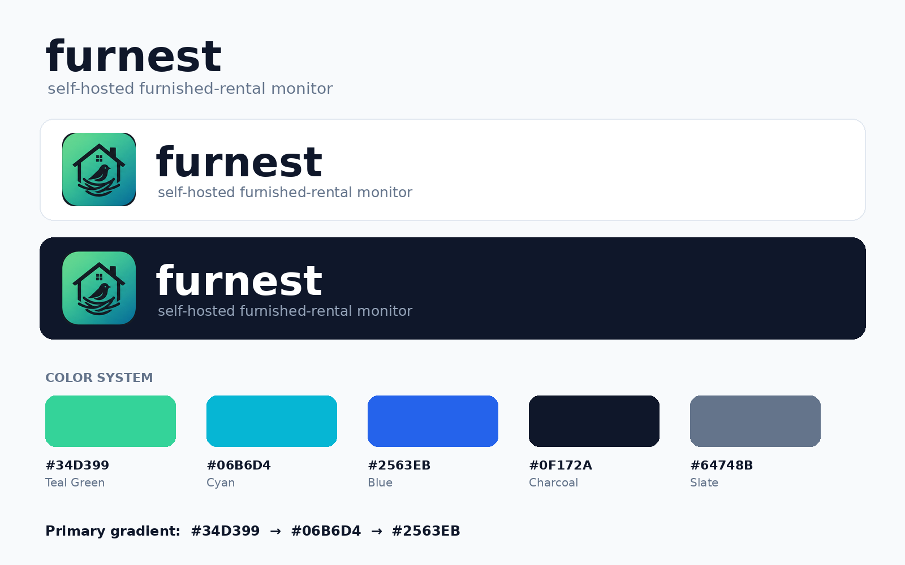

# Brand


furnest is a self-hosted furnished-rental monitor. The identity should feel useful, technical, calm and trustworthy, with a little play. The mark puts a bird on a nest inside a house: home, furnished rentals, something keeping watch, a safe place to land.

The name is always lowercase: **furnest**, even at the start of a sentence or in a title.



## Color

| Token | Hex | Role |
|---|---|---|
| Teal | `#34D399` | Primary accent. Healthy/positive status in dark mode |
| Cyan | `#06B6D4` | Links and buttons in dark mode |
| Blue | `#2563EB` | Links and buttons in light mode |
| Charcoal | `#0F172A` | Text in light mode, page background in dark mode |
| Slate | `#64748B` | Secondary text in light mode |

The primary gradient is `#34D399 → #06B6D4 → #2563EB` at 135°. Use it sparingly: the dashboard shows it only as the 3px strip above the header.

The dashboard's `app.css` defines these colors once as `--furnest-*` tokens and maps them to semantic tokens (`--fg`, `--muted`, `--accent`, `--ok`, …), which are the only ones components use:

| Semantic token | Light | Dark |
|---|---|---|
| `--bg` | `#FFFFFF` | Charcoal `#0F172A` |
| `--surface` | `#F8FAFC` | `#1E293B` |
| `--border` | `#E2E8F0` | `#334155` |
| `--fg` | Charcoal `#0F172A` | `#F1F5F9` |
| `--muted` | Slate `#64748B` | `#94A3B8` |
| `--accent` | Blue `#2563EB` | Cyan `#06B6D4` |
| `--ok` | `#047857` | Teal `#34D399` |

Teal and cyan are too light to use as text on white (below 3:1), so light mode uses blue for links and buttons and a darker green for healthy status. Every text and background pair above meets WCAG AA (4.5:1). Errors keep the existing reds, which are not brand colors.

## Typography

The brand calls for Montserrat SemiBold/Bold for the wordmark and headings, and Inter for UI text. The dashboard uses the system font stack: its CSP is self-only, so web fonts would have to be vendored, and the system UI fonts look close enough at dashboard sizes. The header and login wordmark use bold weight with slightly negative letter-spacing to approximate Montserrat.

## Logo usage

- Use the icon by itself for the favicon, app icon, compact navigation, notifications and avatars. Pair it with the lowercase wordmark where there's room, as the dashboard header and login page do.
- Leave clear space around the icon at least as wide as the chimney.
- Don't stretch, skew or recolor the artwork, and don't add shadows or outlines to it.

## Assets

| File | Use |
|---|---|
| `docs/brand/furnest-icon-1024.png` | Master icon. Every other size is generated from it |
| `docs/brand/furnest-icon-256.png` | README and docs |
| `docs/brand/furnest-brand-board.png` | Overview board from the original kit |
| `src/furnest/web/static/brand/favicon.ico` | 16/32/48 favicon, also served at `/favicon.ico` |
| `src/furnest/web/static/brand/icon-32.png` | PNG favicon |
| `src/furnest/web/static/brand/icon-64.png` | Header logo (shown at 28px, sharp on 2x screens) |
| `src/furnest/web/static/brand/icon-180.png` | `apple-touch-icon` and the login page logo |

There is no vector version yet. The SVGs in the original kit were a rough hand trace that didn't match the artwork, so they were left out. A faithful SVG would allow an SVG favicon and crisp large sizes.

### Regenerating

The master was cropped out of a generated concept image and had a dark rim along its rounded edge. It was cleaned by trimming 24px from each side, scaling back up and masking the corners again (ImageMagick 7):

```sh
magick furnest-icon-1024.png -alpha off -gravity center -crop 976x976+0+0 +repage \
  -resize 1024x1024 \
  \( -size 1024x1024 xc:black -fill white -draw "roundrectangle 0,0 1023,1023 180,180" \) \
  -alpha off -compose CopyOpacity -composite docs/brand/furnest-icon-1024.png
```

To rebuild the other sizes from the master:

```sh
M=docs/brand/furnest-icon-1024.png
S=src/furnest/web/static/brand
magick $M -strip -resize 256x256 docs/brand/furnest-icon-256.png
for s in 32 64 180; do magick $M -strip -resize ${s}x$s $S/icon-$s.png; done
magick $M -strip -define icon:auto-resize=48,32,16 $S/favicon.ico
```
